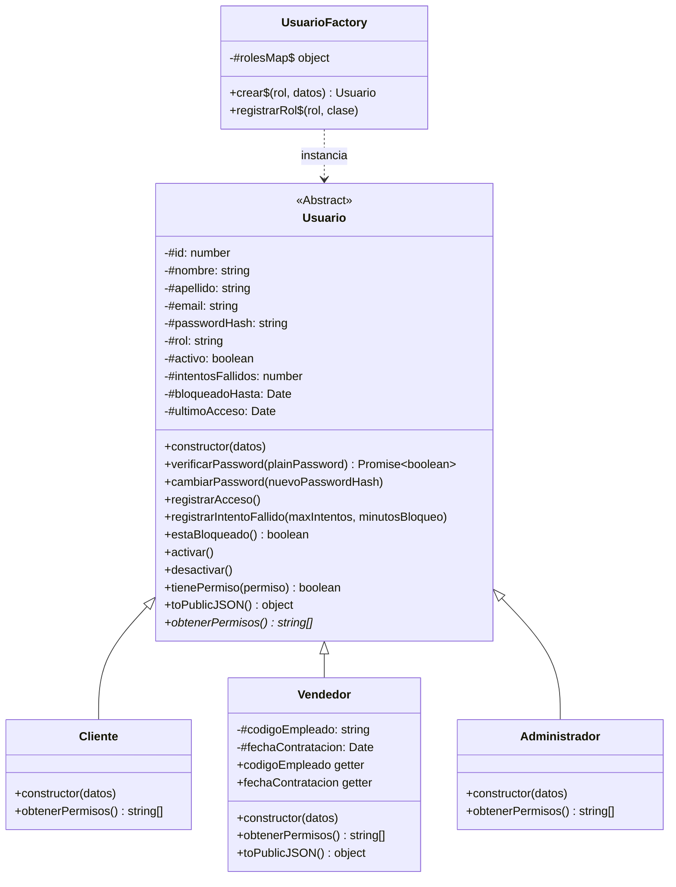
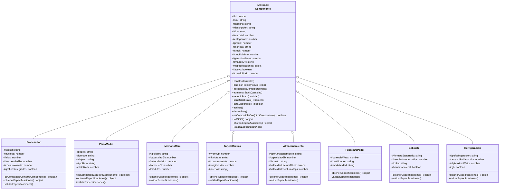
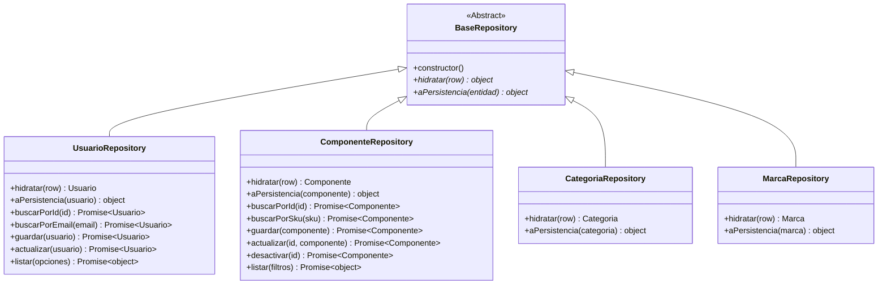
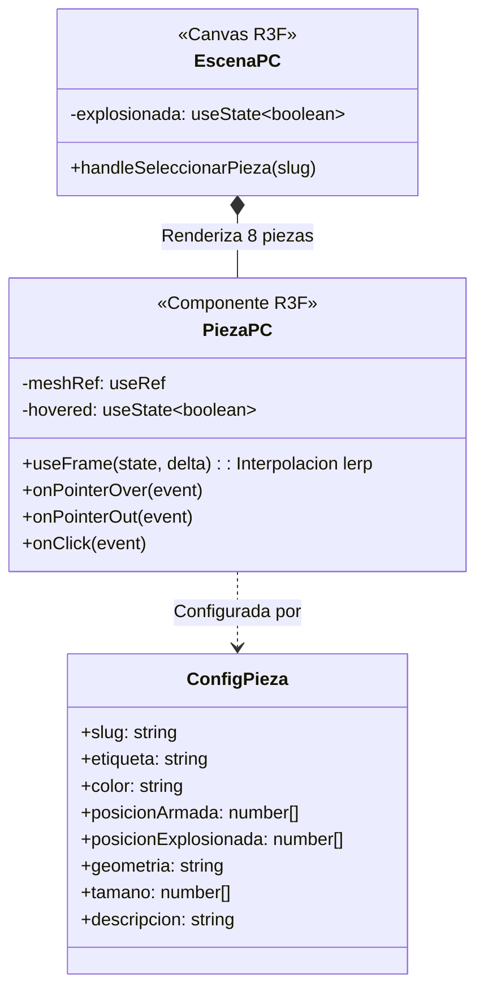
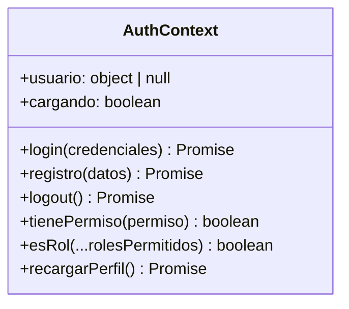

# 📖 Documentación de Clases y Arquitectura POO (Backend & Frontend)

Este documento detalla exhaustivamente **cada clase**, su rol arquitectónico, su composición interna (constructores, campos privados `#`, métodos de negocio, métodos abstractos y polimorfismo) tanto en el **Backend** como en el **Frontend**.

---

## 🏛️ PARTE 1: BACKEND (Node.js + ES Modules)

En el backend, se implementa una arquitectura en capas limpia con **Programación Orientada a Objetos (POO)** pura en JavaScript. Para suplir la falta de palabras clave nativas como `abstract` o `interface`, se aplican patrones de diseño modernos y la especificación de campos privados (`#`).

---

### 1. Jerarquía POO de Usuarios y Autorización

#### 1.1. `Usuario` (Clase Abstracta Base)
- **Ubicación:** `backend/src/modules/usuarios/Usuario.js`
- **Tipo:** Clase Base Abstracta (simulada con `if (new.target === Usuario) throw new Error(...)`).
- **Atributos Privados (`#`):**
  - `#id`: Identificador numérico único de la base de datos.
  - `#nombre`: Nombre del usuario.
  - `#apellido`: Apellido del usuario.
  - `#email`: Correo electrónico único.
  - `#passwordHash`: Hash de la contraseña generado con bcryptjs (nunca se expone fuera de la clase).
  - `#rol`: Rol en el sistema (`CLIENTE`, `VENDEDOR`, `ADMIN`).
  - `#activo`: Estado lógico (true/false).
  - `#intentosFallidos`: Contador de logins fallidos para mitigar ataques de fuerza bruta.
  - `#bloqueadoHasta`: Marca de tiempo hasta la cual la cuenta permanece suspendida por intentos fallidos.
  - `#ultimoAcceso`: Fecha del último inicio de sesión exitoso.
  - `#createdAt`, `#updatedAt`: Trazabilidad temporal.
- **Constructor:**
  - `constructor(datos)`: Inicializa y encapsula cada propiedad privada. Valida que no sea instanciada directamente.
- **Getters Públicos:**
  - `id`, `nombre`, `apellido`, `nombreCompleto`, `email`, `rol`, `activo`, `intentosFallidos`, `bloqueadoHasta`, `ultimoAcceso`, `passwordHash`, `createdAt`, `updatedAt`.
- **Métodos Públicos:**
  - `verificarPassword(plainPassword)`: Compara una contraseña en texto plano contra `#passwordHash` usando `bcryptjs.compare`.
  - `cambiarPassword(nuevoPasswordHash)`: Actualiza el hash de la contraseña de manera segura.
  - `registrarAcceso()`: Registra un login exitoso, restablece `#intentosFallidos = 0` y desbloquea la cuenta.
  - `registrarIntentoFallido(maxIntentos = 5, minutosBloqueo = 15)`: Incrementa los intentos fallidos y, si supera el límite, fija `#bloqueadoHasta` por 15 minutos.
  - `estaBloqueado()`: Retorna `true` si la cuenta está en periodo de bloqueo temporal. Si el tiempo expiró, resetea el bloqueo automáticamente.
  - `activar()` / `desactivar()`: Modifican `#activo` (borrado lógico).
  - `tienePermiso(permiso)`: Evalúa si el permiso solicitado está incluido en los permisos devueltos por `obtenerPermisos()`.
  - `toPublicJSON()`: Serializa los datos del usuario para enviarlos al cliente **omitiendo estrictamente** `#passwordHash`.
- **Método Polimórfico Abstracto:**
  - `obtenerPermisos()`: Lanza excepción si la subclase no lo implementa.

---

#### 1.2. `Cliente` (Subclase)
- **Ubicación:** `backend/src/modules/usuarios/subclases/Cliente.js`
- **Hereda de:** `Usuario`
- **Constructor:** `constructor(datos)` invoca `super({ ...datos, rol: 'CLIENTE' })`.
- **Métodos Polimórficos Sobrescritos:**
  - `obtenerPermisos()`: Retorna exclusivamente `[PERMISOS.CATALOGO_VER]`.

---

#### 1.3. `Vendedor` (Subclase)
- **Ubicación:** `backend/src/modules/usuarios/subclases/Vendedor.js`
- **Hereda de:** `Usuario`
- **Atributos Privados Propios:**
  - `#codigoEmpleado`: Código institucional del empleado.
  - `#fechaContratacion`: Fecha de contratación.
- **Constructor:** `constructor(datos)` invoca `super({ ...datos, rol: 'VENDEDOR' })` e inicializa sus campos privados propios.
- **Getters:** `codigoEmpleado`, `fechaContratacion`.
- **Métodos Polimórficos Sobrescritos:**
  - `obtenerPermisos()`: Retorna `[CATALOGO_VER, COMPONENTE_CREAR, COMPONENTE_EDITAR]`.
  - `toPublicJSON()`: Extiende el JSON base añadiendo `#codigoEmpleado` y `#fechaContratacion`.

---

#### 1.4. `Administrador` (Subclase)
- **Ubicación:** `backend/src/modules/usuarios/subclases/Administrador.js`
- **Hereda de:** `Usuario`
- **Constructor:** `constructor(datos)` invoca `super({ ...datos, rol: 'ADMIN' })`.
- **Métodos Polimórficos Sobrescritos:**
  - `obtenerPermisos()`: Retorna **todos** los permisos del sistema (`Object.values(PERMISOS)`).

---

#### 1.5. `UsuarioFactory` (Patrón Factory)
- **Ubicación:** `backend/src/modules/usuarios/UsuarioFactory.js`
- **Atributos Privados Estáticos:**
  - `#rolesMap`: Diccionario interno `{ CLIENTE: Cliente, VENDEDOR: Vendedor, ADMIN: Administrador }`.
- **Métodos Públicos Estáticos:**
  - `crear(rol, datos)`: Fabrica e hidrata la subclase correcta según el rol.
  - `registrarRol(rol, clase)`: Permite registrar dinámicamente nuevos roles sin modificar el código existente (Principio Abierto/Cerrado).

---

### 2. Jerarquía POO de Componentes de Hardware

#### 2.1. `Componente` (Clase Abstracta Base)
- **Ubicación:** `backend/src/modules/componentes/Componente.js`
- **Atributos Privados (`#`):**
  - `#id`, `#sku`, `#nombre`, `#descripcion`, `#tipo`, `#marcaId`, `#categoriaId`, `#precio`, `#moneda`, `#stock`, `#stockMinimo`, `#garantiaMeses`, `#imagenUrl`, `#especificaciones`, `#activo`, `#creadoPorId`, `#createdAt`, `#updatedAt`, `#marca`, `#categoria`.
- **Constructor:**
  - `constructor(datos)`: Verifica clase abstracta (`new.target`). Valida que `sku` y `nombre` existan, que `precio > 0` y que `stock >= 0`. Encapsula todos los datos en variables privadas.
- **Getters Públicos:**
  - Lectura controlada de cada propiedad privada: `id`, `sku`, `nombre`, `descripcion`, `tipo`, `precio`, `stock`, `stockMinimo`, `especificaciones`, `activo`, etc.
- **Métodos de Negocio Encapsulados:**
  - `cambiarPrecio(nuevoPrecio)`: Valida que el nuevo precio sea un número positivo y lo redondea a 2 decimales.
  - `aplicarDescuento(porcentaje)`: Valida porcentaje entre 1 y 99%, calcula el descuento y delega a `cambiarPrecio`.
  - `aumentarStock(cantidad)`: Valida enteros positivos y suma al inventario `#stock`.
  - `reducirStock(cantidad)`: Valida enteros positivos y comprueba disponibilidad antes de descontar. Si la cantidad solicitada supera el stock disponible, lanza `Error('Stock insuficiente')`.
  - `tieneStockBajo()`: Retorna `true` si `#stock <= #stockMinimo`.
  - `estaDisponible()`: Retorna `true` si `#activo && #stock > 0`.
  - `activar()` / `desactivar()`: Borrado lógico.
  - `esCompatibleCon(otroComponente)`: Método base de compatibilidad (por defecto `true`).
  - `toJSON()`: Serializa el objeto para la API integrando cálculos de negocio (`tieneStockBajo`, `estaDisponible`) y las especificaciones polimórficas.
- **Métodos Abstractos:**
  - `obtenerEspecificaciones()`: Retorna el objeto de especificaciones estructurado según la subclase.
  - `validarEspecificaciones()`: Valida que los campos técnicos específicos no falten.

---

#### 2.2. Subclases de Hardware Especializadas
Cada una reside en `backend/src/modules/componentes/subclases/`:

1. **`Procesador`:**
   - **Campos Privados:** `#socket`, `#nucleos`, `#hilos`, `#frecuenciaGhz`, `#consumoWatts`, `#graficosIntegrados`.
   - **Polimorfismo:** `esCompatibleCon(otroComponente)` verifica si el socket coincide exactamente con el socket de una `PlacaMadre`.
2. **`PlacaMadre`:**
   - **Campos Privados:** `#socket`, `#formato`, `#chipset`, `#tipoRam`, `#slotsRam`.
   - **Polimorfismo:** `esCompatibleCon(otro)` comprueba coincidencia de socket contra `Procesador` y coincidencia de tipo de memoria (DDR4/DDR5) contra `MemoriaRam`.
3. **`MemoriaRam`:**
   - **Campos Privados:** `#tipoRam`, `#capacidadGb`, `#velocidadMhz`, `#latenciaCl`, `#modulos`.
4. **`TarjetaGrafica`:**
   - **Campos Privados:** `#vramGb`, `#tipoVram`, `#consumoWatts`, `#longitudMm`, `#puertos`.
5. **`Almacenamiento`:**
   - **Campos Privados:** `#tipoAlmacenamiento`, `#capacidadGb`, `#formato`, `#velocidadLecturaMbps`, `#velocidadEscrituraMbps`.
6. **`FuenteDePoder`:**
   - **Campos Privados:** `#potenciaWatts`, `#certificacion`, `#modularidad`.
7. **`Gabinete`:**
   - **Campos Privados:** `#formatoSoportado`, `#ventiladoresIncluidos`, `#color`, `#ventanaLateral`.
8. **`Refrigeracion`:**
   - **Campos Privados:** `#tipoRefrigeracion`, `#tamanoRadiadorMm`, `#tdpMaximoWatts`, `#rgb`.

---

#### 2.3. `ComponenteFactory`
- **Ubicación:** `backend/src/modules/componentes/ComponenteFactory.js`
- **Atributos Privados Estáticos:** `#catalogoTipos` con las 8 clases de hardware registradas.
- **Métodos Públicos Estáticos:**
  - `crear(tipo, datos)`: Instancia la subclase correspondiente según el string recibido.
  - `registrar(tipo, clase)`: Permite extender la factoría con nuevos tipos de hardware en caliente.
  - `tiposDisponibles()`: Retorna la lista de tipos soportados.

---

### 3. Entidades Simples: `Categoria` y `Marca`

#### 3.1. `Categoria`
- **Ubicación:** `backend/src/modules/categorias/Categoria.js`
- **Campos Privados:** `#id`, `#nombre`, `#slug`, `#descripcion`, `#orden`, `#activa`, `#createdAt`, `#updatedAt`.
- **Métodos:** Getters, `activar()`, `desactivar()`, `toJSON()`.

#### 3.2. `Marca`
- **Ubicación:** `backend/src/modules/marcas/Marca.js`
- **Campos Privados:** `#id`, `#nombre`, `#paisOrigen`, `#sitioWeb`, `#logoUrl`, `#activa`, `#createdAt`, `#updatedAt`.
- **Métodos:** Getters, `activar()`, `desactivar()`, `toJSON()`.

---

### 4. Capa de Persistencia: `BaseRepository` e Hidratación

#### 4.1. `BaseRepository` (Clase Abstracta)
- **Ubicación:** `backend/src/core/BaseRepository.js`
- **Propósito:** Desacopla la base de datos (Prisma) del modelo de dominio.
- **Métodos Abstractos:**
  - `hidratar(row)`: Convierte un registro crudo de PostgreSQL en una instancia POO rica.
  - `aPersistencia(entidad)`: Convierte una instancia POO en un objeto plano para Prisma.

#### 4.2. Repositorios Concretos
- `UsuarioRepository`: Emplea `UsuarioFactory.crear(row.rol, row)`.
- `ComponenteRepository`: Emplea `ComponenteFactory.crear(row.tipo, row)` y gestiona filtros dinámicos (búsqueda textual insensible a mayúsculas/minúsculas, rangos de precio, categoría por slug o id, paginación).
- `CategoriaRepository` y `MarcaRepository`: Hidratan sus respectivas entidades y ejecutan borrado lógico.

---

### 5. Servicios de Dominio (Inyección de Dependencias)
- `AuthService`: Orquesta hashing de contraseña, control de intentos fallidos, bloqueo temporal y emisión de JWT.
- `UsuariosService`: Gestión de usuarios y mutación de roles.
- `ComponentesService`: Verifica unicidad de SKU y delega creación/actualización a través de la fábrica.
- `CategoriasService` y `MarcasService`: Validaciones de negocio y unicidad de slugs y nombres.

---

### 6. Jerarquía de Errores Controlados
- **Ubicación:** `backend/src/core/errors/AppError.js`
- `AppError` extiende `Error`: Base con propiedades `statusCode`, `codigo` y `detalles`.
- Subclases derivadas:
  - `ValidationError` (400 Bad Request)
  - `AuthenticationError` (401 Unauthorized)
  - `ForbiddenError` (403 Forbidden)
  - `NotFoundError` (404 Not Found)
  - `ConflictError` (409 Conflict)

---

## 🎨 PARTE 2: FRONTEND (React + Three.js)

En el frontend, la arquitectura se basa en **componentes funcionales estructurados**, hooks de estado y sincronización, un proveedor global de autenticación (`AuthContext`), y el subsistema gráfico en 3D basado en **Three.js** y **React Three Fiber**.

---

### 1. Sistema 3D: Ensamblado y Explosión de Piezas

#### 1.1. `piezas.config.js` (Modelo de Datos 3D)
- **Ubicación:** `frontend/src/three/piezas.config.js`
- **Estructura de cada pieza:**
  - `slug`: Coincide exactamente con el slug de la categoría en PostgreSQL (`procesador`, `gpu`, etc.).
  - `etiqueta`: Nombre en español para el tooltip interactivo.
  - `color`: Código hexadecimal para el material metálico.
  - `posicionArmada`: Vector `[x, y, z]` de la pieza dentro del chasis ensamblado.
  - `posicionExplosionada`: Vector `[x, y, z]` en el espacio cuando la vista despiezada está activa.
  - `geometria`: Primitiva geométrica Three.js (`caja` o `cilindro`).
  - `tamano`: Parámetros dimensionales de la geometría.

#### 1.2. `PiezaPC.jsx` (Componente Gráfico Interactivo)
- **Ubicación:** `frontend/src/three/PiezaPC.jsx`
- **Estado Interno:**
  - `meshRef`: Referencia al nodo `THREE.Mesh`.
  - `hovered`: Booleano que rastrea si el puntero del usuario está sobre la pieza.
- **Animación con `useFrame`:**
  - En cada fotograma, ejecuta interpolación lineal (`meshRef.current.position.lerp(targetVec, delta * 3.5)`). Si la PC está en modo explosión, viaja suavemente hacia `posicionExplosionada`; si no, retorna a `posicionArmada`.
  - Si está en estado `hovered`, aplica rotación continua suave sobre el eje Y.
- **Eventos:**
  - `onPointerOver`: Activa `hovered = true`, resalta el material con emisión lumínica y cambia el cursor a `pointer`.
  - `onPointerOut`: Restablece el material original.
  - `onClick`: Detiene la propagación del evento e invoca `onSeleccionar(slug)` para navegar al catálogo.
- **Tooltip 3D:**
  - Mediante `<Html distanceFactor={10}>` de `@react-three/drei`, proyecta una etiqueta flotante 2D anclada en coordenadas 3D directamente sobre la pieza.

#### 1.3. `EscenaPC.jsx` (Contenedor y Cámara)
- **Ubicación:** `frontend/src/three/EscenaPC.jsx`
- **Estado:**
  - `explosionada`: Booleano que alterna entre vista armada y despiezada.
- **Elementos R3F:**
  - `<Canvas>`: Cámara con perspectiva `fov: 45` y posición inicial `[5, 4, 7]`.
  - `<OrbitControls>`: Permite al usuario rotar, hacer zoom y examinar la PC en 360 grados.
  - Botón HUD: Control superior para alternar `explosionada`.
  - `<Stars>` y `<Iluminacion>`: Entorno visual espacial con luces direccionales y acentos de color cian y violeta.

---

### 2. Capa de Estado Global: `AuthContext`

- **Ubicación:** `frontend/src/context/AuthContext.jsx`
- **Estado Gestionado:**
  - `usuario`: Objeto con perfil público y lista de permisos del usuario autenticado.
  - `cargando`: Booleano de verificación inicial de cookie de sesión.
- **Métodos Expuestos:**
  - `login(credenciales)`: Llama a `authApi.login()`, recibe cookie httpOnly y almacena el estado del usuario.
  - `registro(datos)`: Registra un nuevo usuario con rol `CLIENTE`.
  - `logout()`: Invalida la sesión y limpia el estado global.
  - `tienePermiso(permiso)`: Valida si el usuario actual posee un permiso específico (ej. `COMPONENTE_CREAR`).
  - `esRol(...roles)`: Valida si el rol del usuario coincide con alguno de los roles permitidos.
  - Escucha de evento `auth:unauthorized`: Si cualquier petición responde `401`, cierra la sesión automáticamente en memoria.

---

### 3. Vistas y Componentes Clave del Catálogo

| Componente | Ruta de Archivo | Responsabilidad |
| :--- | :--- | :--- |
| `Catalogo.jsx` | `frontend/src/pages/Catalogo.jsx` | Vista principal con sincronización bidireccional entre URL (`?categoria=...`) y estado reactivo. Utiliza TanStack Query para caché y recarga optimista. |
| `TarjetaComponente.jsx` | `frontend/src/components/catalogo/TarjetaComponente.jsx` | Tarjeta con cálculo de badges de stock (`Disponible`, `Bajo stock`, `Agotado`), formateo de moneda y enlace a detalle. |
| `Filtros.jsx` | `frontend/src/components/catalogo/Filtros.jsx` | Barra lateral con selector de categoría, selector de marca, control numérico de precio mínimo/máximo y buscador textual. |
| `DetalleComponente.jsx` | `frontend/src/pages/DetalleComponente.jsx` | Vista extendida que desglosa dinámicamente las especificaciones técnicas del JSON según el tipo de hardware. |
| `FormularioComponente.jsx`| `frontend/src/pages/admin/FormularioComponente.jsx` | Formulario reactivo que cambia sus campos de especificaciones en tiempo real al cambiar el selector `tipo` (POO). |
| `GestionUsuarios.jsx` | `frontend/src/pages/admin/GestionUsuarios.jsx` | Vista protegida para Administradores con mutación de roles (`CLIENTE`, `VENDEDOR`, `ADMIN`) en caliente. |

---

## 📋 Resumen de Relación entre POO y Requisitos Académicos

| Pilar de POO | Implementación en Backend | Implementación en Frontend |
| :--- | :--- | :--- |
| **Encapsulamiento** | Atributos estrictamente privados con `#` en `Usuario`, `Componente`, `Categoria` y `Marca`. El precio y el stock solo pueden alterarse mediante métodos que validan invariantes de negocio. | Estado interno de componentes con hooks y props inmutables hacia componentes hijos. |
| **Abstracción** | Clases abstractas `Usuario`, `Componente` y `BaseRepository` que no pueden ser instanciadas y exigen implementación de contratos. | La factoría `ComponenteFactory` y el cliente HTTP aíslan los detalles de persistencia y red. |
| **Herencia** | 8 subclases de hardware heredan de `Componente`; 3 subclases de roles heredan de `Usuario`. | Subclases de error heredan de `AppError` que a su vez hereda de la clase nativa `Error`. |
| **Polimorfismo** | Cada subclase de `Componente` implementa su propia validación y serialización de especificaciones técnicas (`validarEspecificaciones()`, `obtenerEspecificaciones()`) y reglas de compatibilidad (`esCompatibleCon()`). Cada subclase de `Usuario` implementa `obtenerPermisos()`. | Renderizado dinámico en React según el `tipo` devuelto por el objeto polimórfico de backend. |

